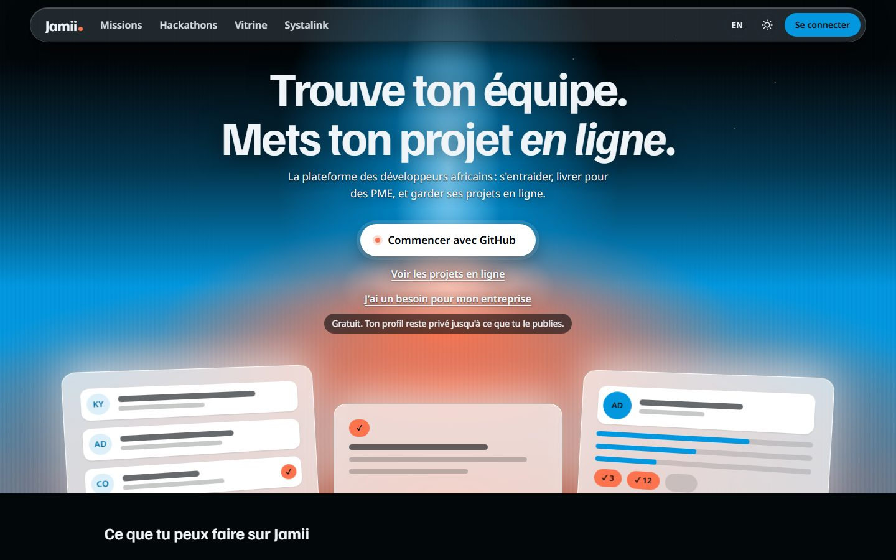
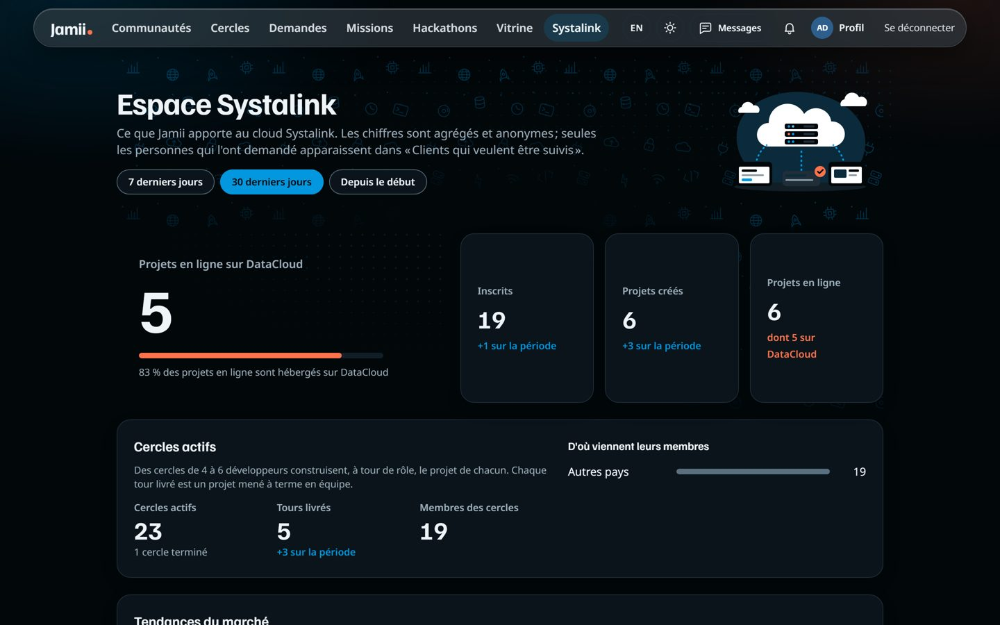
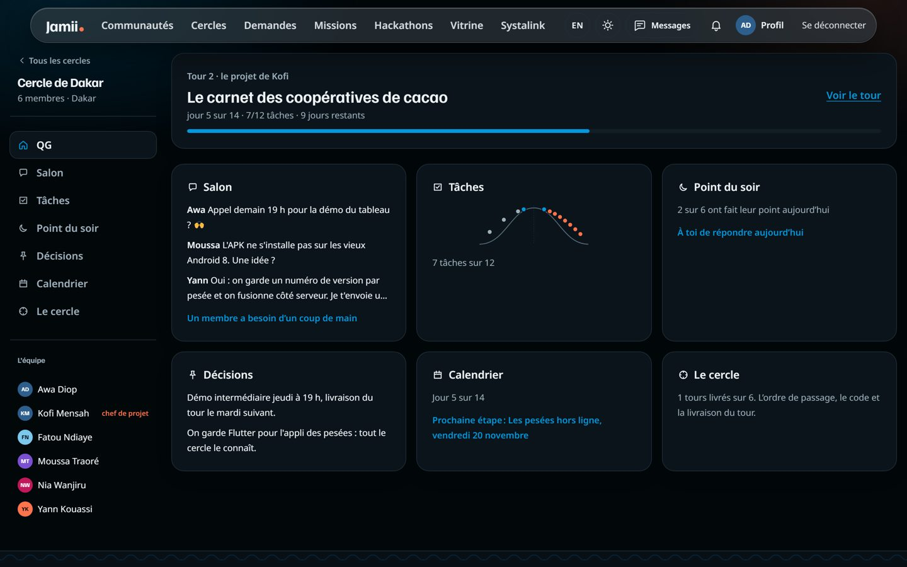
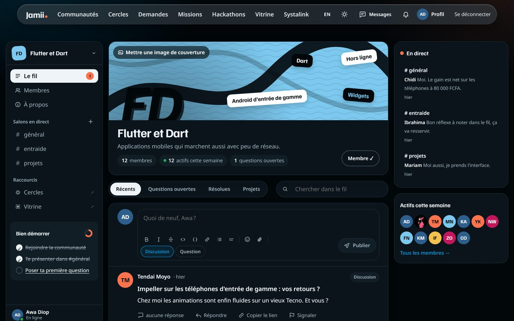
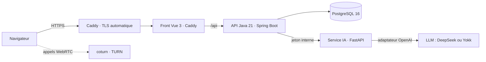

# Jamii

> **La plateforme d'échange des développeurs africains, déjà en ligne sur le cloud Systalink.**
> On s'y rencontre, on construit ensemble, on répond aux besoins des PME, et chaque projet finit en ligne sur DataCloud.

[](https://github.com/algabah2004/jamii/actions/workflows/ci.yml)
[](LICENSE)
[](https://jamii.dev)

*Jamii* veut dire « communauté » en swahili. Projet présenté à la **Coupe d'Afrique des Développeurs (CADEV 2026)** organisée par [Systalink](https://systalink.com), sur le thème : *construire la plateforme d'échange africaine, pour les devs, par les devs*.



---

## Pour le jury, en 2 minutes

| | |
|---|---|
| **Le produit en ligne** | **https://jamii.dev**, hébergé sur un serveur cloud **DataCloud de Systalink**, en HTTPS |
| **Se connecter** | **GitHub** (développeurs) ou **Google** (PME, associations), sans mot de passe. Aucun compte Systalink n'est demandé |
| **L'espace Systalink** | Lien **Systalink** dans le menu. Réservé à l'équipe Systalink : le **code d'accès jury** est donné dans le formulaire de soumission |
| **Le code** | Ce dépôt : une API Java, un front Vue, un service IA Python, 15 contrats OpenAPI, une CI à chaque PR |
| **Ce qui est vérifiable** | Chaque chiffre de ce README se recompte dans le dépôt ou sur le site |

---

## Ce que Jamii rapporte à Systalink

Jamii n'est pas seulement *hébergé* chez Systalink : il est conçu pour **amener des clients à Systalink**, et pour le **prouver avec des chiffres**.

| Pour Systalink | Comment Jamii le fait, concrètement |
|---|---|
| **Des PME qui deviennent clientes** | Une PME décrit son besoin à **Ayo**, l'assistant IA. Ayo ne peut recommander **que** des services du catalogue Systalink ([`catalogue-systalink.yaml`](services/ia/catalogue-systalink.yaml)) : hébergement DataCloud, boutique, site vitrine, nom de domaine… Il dit aussi honnêtement quand un service prêt à l'emploi suffit, sans développeur |
| **Des prospects qualifiés, avec leur accord** | La personne peut cocher « Recevoir les offres Systalink adaptées à mon projet » (jamais cochée d'avance). Elle apparaît alors dans les **clients suivis** de l'espace Systalink, avec son besoin résumé, son secteur et les services adaptés. Export CSV et **webhook signé** vers l'outil commercial de Systalink |
| **Des développeurs qui déploient sur DataCloud** | Chaque projet construit dans un cercle finit **en ligne** ; la vitrine affiche « Hébergé sur Systalink » et le label **« Né dans une Tech Tontine Systalink »** |
| **Une vue du marché africain** | **Tendances du marché**, anonymes et agrégées : les secteurs qui demandent, les pays, les services utiles, les compétences qui manquent. Un pays ou un secteur n'apparaît qu'à partir de 5 besoins, pour que personne ne soit reconnaissable |
| **Une mesure honnête** | Les **moments Systalink** : chaque fois que Jamii propose un service au bon moment, puis chaque fois qu'il est accepté. Le taux de conversion par service est dans le tableau de bord. Ce que Jamii ne voit pas (un achat chez Systalink) n'est pas inventé |
| **Un produit prêt à intégrer le portefeuille** | Marque configurable (nom, logo, couleurs), configuration 100 % par variables d'environnement, conteneurs Docker, standards uniquement (OpenAPI, OAuth2/OIDC, API S3, webhooks signés, PostgreSQL) |



*L'espace Systalink, réservé à son équipe (capture avec des données de démonstration).*

---

## Ce qui est nouveau : trois idées qu'on ne trouve pas ailleurs

### 1. Les cercles : la tontine, appliquée au code

Dans une tontine, chacun reçoit à son tour l'argent mis en commun. Dans un **cercle Jamii**, 4 à 6 développeurs mettent en commun **leur travail** : à chaque tour, tout le cercle construit le projet d'un membre, jusqu'à sa mise en ligne.
- L'ordre de passage est **tiré au sort par le serveur**, jamais par une IA ni par un membre.
- Chaque tour a son salon, ses tâches, son point du soir, ses décisions et son calendrier.
- La répartition des tâches est **calculée** selon les compétences et la charge de chacun : explicable et testée.



### 2. Ayo, un assistant qui conseille vraiment

Une commerçante écrit « je veux vendre mes tissus en ligne ». **Ayo** discute avec elle comme un vrai conseiller :
- il pose une ou deux questions **seulement si c'est nécessaire** ;
- il répond aussi aux questions générales, puis ramène la conversation au besoin ;
- il conseille un service Systalink, des développeurs, ou les deux, avec les prochaines étapes concrètes ;
- son conseil peut devenir **une mission publiée** en un clic.

**Les e-mails et numéros de téléphone sont retirés avant l'envoi à l'IA**, et une discussion se supprime à tout moment.


### 3. Le profil prouvé, et la carte qui fait connaître Jamii

- Le profil d'un développeur se construit **depuis ses dépôts GitHub publics**. Ayo propose une **carte de compétences** avec, pour chacune, les dépôts qui la prouvent. La personne valide avant toute publication.
- **« Partager ma carte »** génère une image prête pour WhatsApp ou LinkedIn (1200 × 630) : nom, rôle, pays, compétences et un **QR code** vers son profil Jamii. Chaque développeur qui partage sa carte fait connaître Jamii à tout son réseau : la croissance vient des utilisateurs eux-mêmes.

---

## Tout ce qu'on peut faire sur Jamii

| Pour | Ce que Jamii apporte |
|---|---|
| **Se rencontrer** | Des **communautés** par ville, langage ou sujet, avec un fil, des questions/réponses et des **salons en direct** |
| **Se parler** | Une **messagerie** : messages privés, **appels audio et vidéo** (WebRTC, jusqu'à 6 dans un cercle), messages vocaux, réponses, corrections, réactions, présence « en ligne », abonnés |
| **Être reconnu** | Le **profil prouvé** et sa **carte partageable** |
| **Construire en équipe** | Les **cercles (Tech Tontine)** |
| **Répondre à un besoin** | Les **demandes** avec **Ayo**, puis les **missions** : propositions, devis, suivi jalon par jalon, avis |
| **Se mesurer** | Les **hackathons**, challenges et concours d'innovation : inscription, équipes, rendu, jury (une note de 1 à 5, jamais pour sa propre équipe), résultats |
| **Montrer** | La **vitrine** des projets en ligne : chaque adresse est vérifiée toutes les 24 heures |

En **français et en anglais** (selon la langue du navigateur), en thème clair et sombre, accessible (tests automatiques axe-core).



---

## Solidité technique

### En chiffres (recomptables dans le dépôt)

| | |
|---|---|
| **262 pull requests** fusionnées, chacune passée par la CI | `gh pr list --state merged` |
| **Plus de 1 100 tests automatisés** : 579 côté API, 478 côté front, 69 côté IA | `@Test`, `it(`, `def test_` |
| **15 contrats OpenAPI** entre les modules | [`contracts/`](contracts/README.md) |
| **65 migrations** de base de données versionnées (Flyway) | `apps/api/src/main/resources/db/migration` |
| **16 modules** dans l'API, chacun avec son responsable | [`docs/equipe.md`](docs/equipe.md) |

### L'architecture



- **Le contrat avant le code** : chaque module publie son contrat OpenAPI, les types du front en sont **générés**. Un module ne dépend jamais de l'implémentation d'un autre.
- **Tout fournisseur passe par un adaptateur** (IA, e-mail, stockage, vérification de liens…) avec une version simulée pour les tests. On change de fournisseur **par la configuration**, sans réécrire de code.
- **L'IA pour comprendre, des règles pour décider** : l'IA lit des dépôts et un texte libre ; la recommandation de développeurs, la répartition des tâches et les chiffres de Systalink sont **calculés**, sans IA, donc gratuits, explicables et testés.

### La sécurité

| | |
|---|---|
| **Accès** | API **fermée par défaut** : chaque route publique est ouverte explicitement. Protection CSRF, cookie de session `HttpOnly`, `Secure`, `SameSite` |
| **Connexion** | OAuth2 (GitHub, Google). Aucun mot de passe stocké. Aucune redirection ouverte. L'API sait aussi envoyer un lien par e-mail **à usage unique**, stocké en empreinte, avec expiration (pas encore proposé sur le site) |
| **Navigateur** | Politique de contenu (CSP) stricte : seuls les scripts de Jamii s'exécutent. HSTS, `Permissions-Policy` (caméra et micro pour les appels seulement), `X-Frame-Options`, `nosniff` |
| **Fichiers envoyés** | Type reconnu **sur le contenu réel**, droits de lecture vérifiés, servis dans un bac à sable (CSP `sandbox`) |
| **Réseau** | Appels sortants interdits vers les adresses internes (SSRF) ; le relais TURN refuse les réseaux privés. Seuls les ports 22, 80, 443 et 3478 sont ouverts |
| **Données personnelles** | Le minimum, avec consentement. Chaque personne peut **exporter ou supprimer** ses données. Les coordonnées ne partent jamais vers l'IA |
| **Chaîne d'approvisionnement** | La CI bloque les secrets dans le code, les licences GPL/AGPL/LGPL, et produit un SBOM de chaque partie. Alertes Dependabot actives |

### L'exploitation

- **Déploiement continu** : chaque fusion dans `main` construit les images Docker (`ghcr.io`), puis le serveur DataCloud se met à jour seul ([`docs/deploiement-datacloud.md`](docs/deploiement-datacloud.md)). Un fichier `PAUSE` fige la version en ligne avant une démo.
- **Sondes de santé** pour l'orchestrateur (`/health/liveness`, `/health/readiness`).
- **Résilience** : si l'IA ne répond plus, Jamii continue (cache, réponse de repli, quotas et budget par jour). Pendant le redémarrage de l'API, le front réessaie au lieu d'afficher une erreur.
- **La CI à chaque PR** : tests de l'API (sur un vrai PostgreSQL), du front (types, tests, accessibilité, build) et du service IA (lint, tests), secrets, licences, hygiène du dépôt, titres conventionnels.

---

## Prêt à rejoindre le portefeuille Systalink

| Service Systalink | Dans Jamii aujourd'hui |
|---|---|
| **DataCloud (hébergement)** | ✅ **En production** : Jamii tourne sur un serveur DataCloud |
| **Yokk (IA)** | 🔌 L'IA passe par un adaptateur au format OpenAI : Yokk se branche **par la configuration**. En production aujourd'hui : DeepSeek |
| **Orion, boutique, site vitrine, domaines** | ✅ Recommandés par Ayo au bon moment, avec un lien vers l'offre (pas d'API publique à ce jour) |
| **Webhooks / CRM** | ✅ Les clients suivis partent vers l'outil de Systalink par un **webhook signé** |
| **Compte Systalink (OIDC)** | 🔌 La connexion passe par une interface OIDC : « Se connecter avec Systalink » s'ajoute comme un fournisseur de plus |

Le détail de chaque branchement : [`docs/integration-systalink.md`](docs/integration-systalink.md).

---

## Lancer Jamii en local

```bash
cp .env.example .env          # puis compléter les valeurs
docker compose up -d          # PostgreSQL
# API, service IA et front : voir docs/installation.md
```

Guide complet : [`docs/installation.md`](docs/installation.md). Un profil `demo` charge des données de démonstration (cercles, communautés, missions, hackathons).

---

## L'équipe

Cinq développeurs, un module de bout en bout chacun (front, API, base, tests) :

| | Module |
|---|---|
| [@algabah2004](https://github.com/algabah2004) | Chef de projet · agents IA (Ayo), espace Systalink, déploiement DataCloud et CI |
| [@rev22rse22](https://github.com/rev22rse22) | Communautés, messagerie, profils et identité visuelle |
| [@Amar233-ui](https://github.com/Amar233-ui) | Cercles, projets, vitrine, appels audio et vidéo |
| [@sowibrr](https://github.com/sowibrr) | Demandes et missions, socle de l'API et connexion |
| [@boubacarsidibe](https://github.com/boubacarsidibe) | Tests de l'hébergement Java et Python sur DataCloud, règlement CADEV |

Comment on travaille : [`docs/equipe.md`](docs/equipe.md) et [`CONTRIBUTING.md`](CONTRIBUTING.md).

---

## Usage de l'IA (déclaration CADEV)

- **Pour construire Jamii** : des agents de code (dont Claude Code) ont aidé à écrire la documentation, les contrats, le code et les tests. **Chaque PR a été relue par un humain** avant fusion, et le déclare dans sa description.
- **Dans Jamii** : Ayo (`services/ia`) propose la carte de compétences et oriente les besoins. L'IA propose, l'humain décide.

Le détail par membre : [`docs/cadev.md`](docs/cadev.md#ce-quon-déclare-usage-de-lia).

## Licence

**Apache 2.0** ([LICENSE](LICENSE)). Toutes les dépendances sont sous licence permissive (MIT, Apache 2.0, BSD…) ; le job CI « Licences autorisées » le vérifie à chaque PR.

## Documentation

- [`docs/cadev.md`](docs/cadev.md) : la compétition, le problème à résoudre et les cas d'usage
- [`docs/integration-systalink.md`](docs/integration-systalink.md) : comment Jamii se branche sur l'écosystème Systalink
- [`docs/architecture.md`](docs/architecture.md) : la stack et la raison de chaque choix
- [`docs/concept.md`](docs/concept.md) : la vision du produit · [`docs/vocabulaire.md`](docs/vocabulaire.md) : les mots de l'interface
- [`docs/propositions/`](docs/propositions/README.md) : les propositions et les décisions prises
- [`AGENTS.md`](AGENTS.md) : les consignes données aux agents IA de l'équipe

---

### In English

**Jamii** ("community" in Swahili) is the exchange platform for African developers, **live at [jamii.dev](https://jamii.dev) on Systalink's DataCloud**. Developers meet in communities, build each other's projects in rotating **circles** (a tech version of the African *tontine*), answer small businesses' needs with **Ayo**, an AI advisor restricted to Systalink's catalogue, and ship every project online. Systalink gets a private space with consented, qualified leads (signed webhook, CSV), anonymous market trends and measured conversion of each recommended service. Built with Java 21 / Spring Boot, Vue 3 / TypeScript, Python / FastAPI and PostgreSQL; 15 OpenAPI contracts, 1,100+ automated tests, CI on every PR, continuous deployment, strict security headers and a pluggable LLM provider (DeepSeek today, Yokk by configuration). Apache 2.0.
