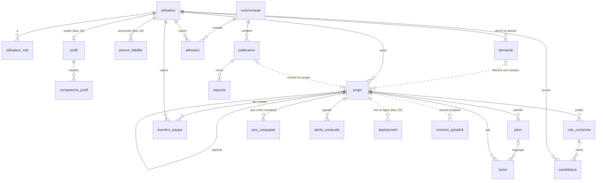

# Modèle de données v1

**Responsable : @sowibrr** ([#7](https://github.com/algabah2004/jamii/issues/7)) · **Statut : proposition**, à valider par chaque bloc pour ses propres tables · Date : 10 novembre 2026

Ce document fixe **les entités de Jamii, qui possède quoi, et comment les modules se relient**. Chaque bloc reste maître de ses tables : il peut renommer un champ ou en ajouter. En revanche, **une relation entre deux blocs** (une flèche qui traverse le tableau du §2) se discute ici avant le code.

Les noms reprennent [vocabulaire.md](vocabulaire.md) : Profil, Communauté, Demande, Mission, Projet, Équipe.

## 1. Les règles communes

| Règle | Pourquoi |
|---|---|
| Une seule base **PostgreSQL**. Le schéma `public` appartient à l'API (Flyway), le schéma `ia` au service IA (#20) | Une base gérée suffit sur DataCloud. Chaque application garde ses migrations ([#32](https://github.com/algabah2004/jamii/pull/32)) |
| Identifiants **UUID**, générés par l'application | Ne révèle ni le volume ni l'ordre de création (une PME n'apprend pas qu'elle est la 12e) |
| Dates en `TIMESTAMPTZ` UTC : `cree_le`, `mis_a_jour_le` | Un utilisateur à Dakar et un autre à Nairobi voient la même heure, chacun dans son fuseau |
| Champ `version` sur ce que plusieurs personnes modifient (projet, tâche, publication) | Deux coéquipiers qui modifient la même tâche : le second reçoit un `409` au lieu d'écraser le premier ([api-conventions.md](api-conventions.md) §7) |
| **Clé étrangère seulement à l'intérieur d'un module, ou vers `utilisateur`.** Entre deux modules métier, on garde l'identifiant sans contrainte | Un module peut évoluer, ou devenir un service, sans casser les autres. `ModulesTest` vérifie déjà la même frontière dans le code |
| Un **nom unique** par personne (`nom`), jamais prénom + nom de famille | Beaucoup de noms du continent ne rentrent pas dans ce découpage occidental |
| Pays : code **ISO 3166-1 alpha-2** (`SN`, `CI`, `KE`…). Ville : texte libre | Filtrer par pays de façon fiable, sans imposer une liste de villes |
| Énumérations en `snake_case` minuscule, protégées par une contrainte `CHECK` | Les mêmes valeurs que dans les contrats OpenAPI |

**Suppression d'un compte** (`DELETE /api/me`) : on efface les données personnelles (profil, adhésions, candidatures en cours). Les **contenus utiles aux autres** (réponses, tâches livrées) restent, avec un auteur à `NULL` (`ON DELETE SET NULL`) affiché « compte supprimé ».

## 2. Qui possède quoi

| Module (paquet) | Bloc | Tables |
|---|---|---|
| `auth` (socle) | #17 @sowibrr | `utilisateur`, `utilisateur_role`, `spring_session*` ✅ déjà dans [#31](https://github.com/algabah2004/jamii/pull/31) · `jeton_connexion` (lien par e-mail) |
| `demandes` | #17 @sowibrr | `demande` |
| `projets` | #17 @sowibrr | `projet`, `role_recherche`, `candidature`, `membre_equipe`, `jalon`, `tache`, `avis_coequipier`, `alerte_continuite` |
| `profils` | #19 @rev22rse22 | `profil`, `competence_profil`, `preuve_fiabilite` |
| `communautes` | #18 @Amar233-ui | `communaute`, `adhesion`, `publication`, `reponse`, `signalement` |
| `deploiement` | #20 @boubacarsidibe | `deploiement` |
| `systalink` | #18 @Amar233-ui | `moment_systalink` |
| schéma `ia` | #20 @boubacarsidibe | file de tâches et cache du service IA (voir #35) |

## 3. Le diagramme

Les flèches en pointillés traversent une frontière de module : on garde l'identifiant, sans clé étrangère.

## 4. Les entités du bloc Socle et Projets (#17)

### `utilisateur` ✅ (migration V3 de #31)
`id`, `nom` (100), `email` (vérifié uniquement, unique sans tenir compte des majuscules), `avatar_url`, `github_id` (unique), `login_github`, `cree_le`, `mis_a_jour_le`. Rôles globaux dans `utilisateur_role` : `membre`, `moderateur`, `admin`.

### `jeton_connexion` (lien de connexion par e-mail)
`id`, `email`, `empreinte` (SHA-256 du jeton : le jeton lui-même n'est jamais stocké), `expire_le` (+15 min), `utilise_le`, `cree_le`.
- Usage unique : la confirmation renseigne `utilise_le` dans la même transaction (`UPDATE … WHERE utilise_le IS NULL`).
- Une tâche de nettoyage supprime les jetons de plus de 24 h.

### `demande` (le besoin d'une PME)
`id`, `auteur_id` → utilisateur, `organisation` (nom de la PME ou de l'association, 150), `titre`, `besoin` (texte de la PME), `pays`, `ville`, `statut`, `cree_le`, `mis_a_jour_le`, `version`.
- `statut` : `brouillon` → `publiee` → `en_mission` (une équipe l'a prise) → `livree` ou `fermee`.
- Pas de budget ni de paiement : les missions payées sont hors périmètre ([concept.md](concept.md)).

### `projet`
`id`, `titre`, `description`, `origine` (`idee` | `demande`), `demande_id` (sans clé étrangère vers `demandes`, voir §1), `porteur_id` → utilisateur, `projet_repris_id` → projet, `statut`, `derniere_activite_le`, `cree_le`, `mis_a_jour_le`, `version`.
- `statut` : `recrutement` → `en_cours` ⇄ `en_pause` → `livre`, ou `abandonne`.
- **Une demande n'a qu'un seul projet actif** : index unique sur `demande_id` quand le statut n'est ni `abandonne` ni `livre`.
- **Reprise** : une autre équipe crée un nouveau projet avec `projet_repris_id`. L'historique de l'ancienne équipe reste intact, et chacun garde ses preuves.
- `derniere_activite_le` est mis à jour à chaque tâche, membre ou jalon modifié. C'est la base de la détection d'inactivité.

### `role_recherche`
`id`, `projet_id`, `titre` (« Développeur mobile Flutter »), `competences` (`TEXT[]`, index GIN pour la recherche), `statut` (`ouvert` | `pourvu` | `ferme`), `cree_le`.

### `candidature`
`id`, `role_recherche_id`, `candidat_id` → utilisateur, `message`, `statut` (`envoyee` | `acceptee` | `refusee` | `retiree`), `cree_le`, `decidee_le`.
- **Une seule candidature active** par personne et par rôle : index unique partiel sur (`role_recherche_id`, `candidat_id`) quand `statut = 'envoyee'`.
- On ne candidate pas à son propre projet, ni à un rôle `pourvu` (règle vérifiée par l'API).
- Accepter une candidature fait trois choses dans **une seule transaction** : elle crée le `membre_equipe`, passe le rôle à `pourvu` et refuse les autres candidatures sur ce rôle.

### `membre_equipe` (l'équipe d'un projet)
`projet_id`, `utilisateur_id`, `role_recherche_id` (facultatif), `rejoint_le`, `parti_le`.
- **L'équipe n'est pas une table à part** : c'est l'ensemble des membres actifs d'un projet (`parti_le IS NULL`). Une équipe sans projet n'a pas de sens dans Jamii, et la reprise crée un nouveau projet, donc une nouvelle équipe.
- **Un membre qui part** : on renseigne `parti_le`, sans supprimer la ligne (sa contribution reste prouvée), et on rouvre son rôle.
- **Le porteur ne peut pas partir** sans avoir transmis le projet à un autre membre.

### `jalon` et `tache`
- `jalon` : `id`, `projet_id`, `titre`, `echeance` (date), `statut` (`prevu` | `atteint`), `ordre`.
- `tache` : `id`, `projet_id`, `jalon_id` (facultatif), `titre`, `assignee_id` → utilisateur, `statut` (`a_faire` | `en_cours` | `livree`), `echeance`, `livree_le`, `proposee_par_ia` (booléen), `version`.
- `livree_le` comparé à `echeance` alimente l'indice de fiabilité du profil (#19), via un événement (§6).

### `avis_coequipier`
`id`, `projet_id`, `auteur_id` → utilisateur, `destinataire_id` → utilisateur, `sens` (`positif` | `negatif`), `texte` (280 caractères au plus), `cree_le`.
- Un seul avis par auteur, par destinataire et par projet : index unique (`projet_id`, `auteur_id`, `destinataire_id`), et CHECK `auteur_id <> destinataire_id`.
- Possible quand le destinataire a une tâche `livree` dans le projet, ou quand le projet est `livre`. L'avis ne se modifie pas : on le conteste depuis le profil (#19).

### `alerte_continuite`
`id`, `projet_id`, `type` (`inactif` | `membre_parti` | `echeance_depassee`), `cree_le`, `resolue_le`.
- Une tâche planifiée signale un projet `en_cours` sans activité depuis **14 jours** (valeur à ajuster). Index sur (`statut`, `derniere_activite_le`).
- Une seule alerte ouverte par projet et par type : index unique partiel quand `resolue_le IS NULL`.

## 5. Les entités des autres blocs (proposition à valider par leur responsable)

### Profils (#19) — @rev22rse22
- `profil` : `utilisateur_id` (clé primaire, une ligne par compte), `bio`, `pays`, `ville`, `disponibilite` (`disponible` | `occupe` | `indisponible`), `publie` (faux par défaut : le profil reste privé jusqu'à sa publication), `resume_ia`, `mis_a_jour_le`.
- `competence_profil` : `utilisateur_id`, `competence` (texte normalisé en minuscules : `flutter`, `postgresql`), `source` (`github` | `declaree`).
- `preuve_fiabilite` : `id`, `utilisateur_id`, `type` (`tache_livree_a_temps` | `avis_coequipier` | `reponse_acceptee` | `projet_en_ligne`), `source_id`, `detail`, `contestee`, `cree_le`. **Chaque point de l'indice est une ligne** qu'on peut afficher (« pourquoi ? ») et contester. On ne stocke pas de note globale, comme le veut le concept.

### Communautés (#18) — @Amar233-ui
- `communaute` : `id`, `slug` (unique), `nom`, `description`, `theme`, `pays` (renseigné pour une **antenne locale**, vide sinon), `cree_le`.
- `adhesion` : `communaute_id`, `utilisateur_id`, `role` (`membre` | `moderateur`), `rejoint_le`.
- `publication` : `id`, `communaute_id`, `auteur_id`, `type` (`question` | `discussion` | `montre_ton_projet`), `titre`, `contenu`, `projet_id` (pour « Montre ton projet »), `reponse_acceptee_id`, `cree_le`, `version`. Index (`communaute_id`, `cree_le DESC`) pour la pagination par curseur.
- `reponse` : `id`, `publication_id`, `auteur_id` (vide si elle vient de l'IA), `contenu`, `proposee_par_ia`, `validee_par_id` (le pair qui a validé une réponse de l'IA), `cree_le`.
- `signalement` : `id`, `cible_type`, `cible_id`, `auteur_id`, `motif`, `statut` (`ouvert` | `traite` | `rejete`), `traite_par_id`, `cree_le`.

### Mise en ligne (#20) — @boubacarsidibe
- `deploiement` : `id`, `projet_id`, `hebergeur` (`datacloud` | `autre`), `url`, `statut` (`en_cours` | `en_ligne` | `echec`), `verifie_le` (la dernière fois que l'URL a répondu), `cree_le`.
- **La vitrine n'est pas une table** : ce sont les projets ayant un déploiement `en_ligne` vérifié récemment.

### Tableau de bord Systalink (#18)
- `moment_systalink` : `id`, `service` (`datacloud` | `orion` | `yokk` | `systatalk` | `systaforms` | …), `contexte` (`projet` | `demande` | `communaute`), `contexte_id`, `propose_le`, `accepte_le`. **Aucun identifiant d'utilisateur** : le tableau de bord ne montre que des chiffres agrégés, et Systalink ne voit pas qui a cliqué.

## 6. Comment les modules se parlent

- **Par l'API publique d'un module** (un service Java exposé), jamais par ses tables. Exemple : `communautes` vérifie qu'un `projet_id` existe en appelant `projets`, pas en lisant la table `projet`.
- **Par des événements** quand un module doit réagir sans que l'autre l'attende. Exemples : `TacheLivree` → `profils` ajoute une `preuve_fiabilite` ; `AvisCoequipier` (`avisId`, `projetId`, `auteurId`, `destinataireId`, `sens`, `texte`, `creeLe`) → idem ; `ReponseAcceptee` → idem ; `ProjetMisEnLigne` → vitrine et profils. Pour fiabiliser ces événements, on pourra activer le registre d'événements de Spring Modulith (stocké en base).
- **Le service IA** ne lit aucune table de l'API : l'API lui envoie ce qu'il faut par HTTP ([`contracts/ia.yaml`](https://github.com/algabah2004/jamii/pull/32)), sans donnée personnelle.

## 7. Questions ouvertes

- ❓ **@rev22rse22** : faut-il une liste fermée de compétences (référentiel), ou du texte libre normalisé suffit-il pour la recherche de coéquipiers ? Le texte libre est plus simple, mais `react` et `react.js` seront deux compétences différentes.
- ❓ **@Amar233-ui** : une **antenne locale** est-elle une communauté avec un `pays` (comme proposé), ou un concept à part ?
- ❓ **@boubacarsidibe** : un projet peut-il avoir plusieurs déploiements actifs (front et API séparés) ? Le modèle le permet déjà.
- ❓ **@algabah2004** : la durée d'inactivité avant alerte (14 jours proposés), et un projet de démo peut-il être **public sans connexion** (vitrine visible par tous) ?
