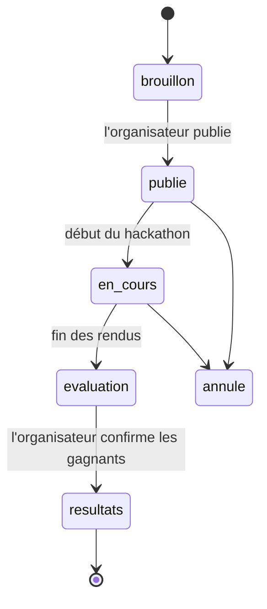
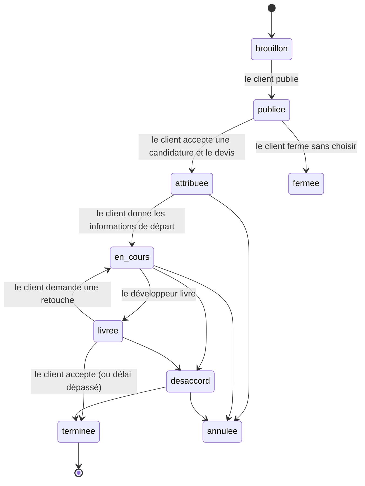

# 0004 · Hackathons et missions freelance

| | |
|---|---|
| **Auteur** | @sowibrr |
| **Date** | 2026-11-14 |
| **Statut** | En discussion |
| **Décision** | *(remplie par le chef de projet, avec la raison)* |

> Suivi : #166 (une tâche par ticket, #167 à #181). Module concerné : **Freelance (#158)**, dont il est la suite.

## Le problème

Aujourd'hui, une PME publie un besoin (#158) et des développeurs forment un cercle pour le construire. Il manque deux choses que les développeurs du continent utilisent ailleurs :

1. **Un cadre pour une mission confiée à une seule personne** : qui est choisi, pour quel prix, quelles étapes, comment on livre et comment on termine. Sans ça, l'échange sort de Jamii (WhatsApp, e-mail) et on perd la trace du travail fait, donc le profil prouvé.
2. **Un hackathon de bout en bout** : aujourd'hui les organisateurs (écoles, communautés, entreprises comme Systalink) passent par Devpost, Devfolio ou des formulaires et des tableurs. Les équipes et les projets nés pendant l'événement disparaissent ensuite.

Ce sont des **suppositions** tirées des plateformes existantes (Devpost, Devfolio, Upwork, Fiverr, Malt), pas encore d'entretiens (#10).

## La proposition

- **Les missions prolongent le module `demandes`** : une demande publiée (#158) est l'annonce de la mission. On y ajoute les propositions, le devis, le suivi par jalons, la livraison et la fin. Quand c'est une équipe qui travaille, la mission passe au cercle (@Amar233-ui), sans dupliquer ses tâches et jalons.
- **Les hackathons sont un nouveau module** `hackathons`, avec son contrat `hackathons.yaml`.
- **Le paiement n'est pas encaissé dans la v1** : chacun le déclare. Il passe par une interface interne, pour brancher plus tard un séquestre par paiement mobile sans réécrire le module.

## Le workflow

### 1. Le hackathon

#### Les rôles

| Rôle | Ce qu'il fait |
|---|---|
| **Organisateur** | Crée le hackathon, accepte les participants, invite le jury, publie les résultats |
| **Participant** | S'inscrit seul ou en équipe, rend un projet |
| **Juré** | Note les projets qu'on lui confie |
| **Sponsor** (facultatif) | Offre un prix et choisit son gagnant (ex. Systalink : « meilleur projet sur DataCloud ») |

#### Les états

#### Les étapes

**1. Créer (brouillon)** — l'organisateur remplit :
- le nom, le thème, la description, le lieu (**en ligne, sur place ou hybride**) ;
- **le calendrier** : ouverture et fin des inscriptions, début, fin des rendus, évaluation, résultats ;
- les règles et **le code de conduite** (obligatoire, comme chez MLH) ;
- **la taille des équipes** (par exemple 1 à 5) ;
- **le mode d'inscription** : ouvert à tous, ou **sur candidature** (l'organisateur accepte, refuse ou met en liste d'attente, comme sur Devfolio) ;
- **les critères de notation, pondérés**, notés de 1 à 5 (comme sur Devpost) ;
- **les prix** : le prix principal, et les prix de sponsors ;
- **ce qu'un rendu doit contenir** : lien du produit, dépôt de code, vidéo, et des questions propres au hackathon (Devpost le permet) ;
- **le déploiement obligatoire ou non** ;
- **le jury** : invitations par e-mail ou par profil Jamii.

Tant que c'est un brouillon, rien n'est visible.

**2. Publier**
- La page du hackathon devient publique et les inscriptions s'ouvrent.
- **Un hackathon avec des prix en argent** ne se publie qu'après vérification de l'organisateur (contre les faux hackathons).

**3. S'inscrire et former les équipes**
- Un participant s'inscrit **seul** ou **crée une équipe** et invite des membres.
- Un tableau **« Je cherche une équipe »** montre les participants seuls, avec leurs compétences ; une équipe peut les inviter.
- **Sur candidature** : l'organisateur trie les inscriptions (accepter, refuser, liste d'attente), seul ou en masse, et chacun est prévenu.
- **À la fin des inscriptions, les équipes sont verrouillées.**

**4. Pendant le hackathon (en cours)**
- L'organisateur publie des **annonces** ; un fil de **questions et réponses** est ouvert.
- Chaque équipe peut travailler dans **un projet Jamii** (tâches, jalons), si elle le veut.

**5. Rendre le projet**
- Chaque équipe remplit son rendu : description, lien, dépôt, vidéo, réponses aux questions. **Elle peut le modifier jusqu'à l'heure limite**, puis il est **verrouillé**.
- **Jamii vérifie que le lien répond** et le note. Une équipe dont le lien ne répond pas est prévenue avant la fin.
- Systalink est **proposé, jamais imposé** pour déployer.

**6. Évaluer**
- L'organisateur **répartit les projets entre les jurés** (par groupes, comme les « salles » de Devfolio), ou chaque juré voit tout.
- **Un juré ne note pas un projet de son équipe ou de son organisation** (conflit d'intérêts).
- Chaque juré note **chaque critère de 1 à 5**, avec un commentaire. Jamii calcule le score pondéré.
- L'organisateur suit **l'avancement de la notation** (qui a noté quoi) et peut **exporter les notes en CSV**.
- **Un sponsor** voit les projets candidats à son prix et choisit son gagnant.

**7. Publier les résultats**
- L'organisateur **confirme les gagnants** de chaque prix (le classement proposé par les notes peut être ajusté, avec une raison).
- Les résultats sont publiés : classement, prix, et **un retour du jury pour chaque équipe**.
- Après publication, seul l'organisateur peut corriger, et la correction est tracée.

**8. Après le hackathon**
- Les projets restent visibles sur la page du hackathon.
- **Une équipe peut transformer son projet en projet Jamii**, pour continuer après les prix : c'est ce qui nous distingue de Devpost.

### 2. La mission freelance

#### Les rôles

| Rôle | Ce qu'il fait |
|---|---|
| **Client** | Une personne, une PME, une association. Publie la mission, choisit, valide |
| **Développeur** | Candidate, livre |
| **Modération Jamii** | Tranche un désaccord, retire une mission abusive |

#### Les états

#### Les étapes

**1. Publier la mission** — le client remplit :
- le titre, le besoin en mots simples, les compétences, le **budget** (dans sa devise) ou « à discuter », la date souhaitée ;
- **publique** ou **sur invitation** (le client invite des développeurs choisis, comme sur Upwork) ;
- des questions pour les candidats, s'il le veut.

**Publier est gratuit** (comme sur Upwork).

**2. Recevoir des candidatures**
- Un développeur envoie **une proposition** : son approche, son prix, son délai, et les jalons qu'il propose.
- **Contre le spam**, un développeur a un nombre limité de candidatures par jour. C'est gratuit, contrairement aux « Connects » payants d'Upwork, pour ne pas exclure les étudiants.
- Le client compare les propositions, avec le profil de chaque développeur, et peut **échanger par messages**.

**3. Choisir et fixer le devis**
- Le client **retient une candidature**. Le développeur envoie **un devis** : le travail attendu, **les jalons** (étapes avec un montant et une date), le **nombre de retouches** compris.
- **Le devis accepté par les deux vaut contrat** (comme sur Malt). Les autres candidats sont prévenus.

**4. Financer (le paiement)**
- Le modèle de référence : le client **met l'argent de chaque jalon en séquestre** avant le travail, et il n'est versé qu'après validation (Upwork, Malt).
- **Dans la v1, Jamii n'encaisse rien** : le paiement se fait en dehors, et chacun indique « payé » ou « reçu ». Le paiement passe par une **interface interne** (un adaptateur simulé maintenant, un adaptateur de paiement mobile ensuite), pour brancher le vrai séquestre sans réécrire le module.

**5. Démarrer**
- Le client donne **les informations de départ** (accès, contenus, logo…). **Le délai commence quand elles sont données** (comme sur Fiverr).
- Le développeur peut **demander un délai supplémentaire**, avec une raison ; le client accepte ou refuse.

**6. Livrer un jalon**
- Le développeur **livre** : un lien de test, des fichiers, un message.
- Le client a **3 jours** pour **accepter** ou **demander une retouche** (dans la limite du devis). **Sans réponse, le jalon est accepté** (comme sur Fiverr), pour qu'un développeur ne reste pas bloqué.
- On recommence pour chaque jalon.

**7. Terminer**
- Quand le dernier jalon est accepté, **la mission est terminée**.
- Chacun laisse **un avis** (seulement après une mission terminée : pas de faux avis).
- La mission entre dans le **profil prouvé** du développeur.
- Si le client veut continuer, **la mission peut devenir un projet Jamii** (équipe, tâches, suivi).

**8. Annuler ou trancher un désaccord**
- **Annulation d'un commun accord**, à tout moment.
- **Annulation par une seule partie** seulement dans des cas précis : le client n'a jamais donné les informations de départ, ou la livraison a beaucoup de retard (comme sur Fiverr).
- Sinon, **un désaccord** est ouvert : les deux s'expliquent, puis **la modération Jamii tranche**.

### 3. Les règles communes

- **Un compte récent** a des limites : peu de hackathons ou de missions publiés par jour.
- **On peut signaler** un hackathon ou une mission (arnaque, travail gratuit déguisé).
- **Les montants** sont dans la devise de la personne (XOF, KES, NGN, GHS…).
- **Les notifications** préviennent chacun à chaque étape (par le module réseau).
- **Les données personnelles** (inscriptions, rendus, notes, propositions, avis) entrent dans **l'export et la suppression du compte**.
- **L'IA n'est pas nécessaire au module.** Elle pourra aider plus tard (rédiger une annonce), toujours avec un repli sans IA.

## Alternatives envisagées

| Option | Avantages | Inconvénients |
|---|---|---|
| **A. Cette proposition** (missions dans `demandes`, hackathons en module à part) | Réutilise la demande publiée et les cercles ; chaque module reste petit | Deux contrats nouveaux à tenir ; un module de plus |
| B. Tout dans un seul module « freelance » | Un seul responsable, un seul contrat | Un module trop gros, qui mélange deux métiers (un concours et un contrat de travail) |
| C. Renvoyer vers Devpost et Upwork | Aucun code | Les projets et les profils prouvés sortent de Jamii ; aucun lien avec Systalink |
| D. Ne rien faire | Aucun risque | Le parcours s'arrête à la publication de la demande |

## Risques et points faibles

- **Argent** : sans séquestre, Jamii ne protège ni le client ni le développeur. On le dit clairement à l'écran (« paiement en dehors de Jamii ») et on garde la trace de ce qui est déclaré.
- **Abus** : faux hackathons avec des prix, missions qui cachent du travail gratuit, spam de candidatures. Réponses : limites par jour pour les comptes récents, signalement, vérification de l'organisateur avant de publier un prix en argent.
- **Liens fournis par les participants** : la vérification d'un lien de rendu ne doit jamais appeler une adresse interne (SSRF).
- **Export CSV des notes** : protégé contre l'injection de formules.
- **Données personnelles** : inscriptions, rendus, notes, propositions et avis entrent dans l'export et la suppression du compte.
- **Charge** : un hackathon reste petit (quelques centaines d'inscrits) ; pas de calcul lourd, le statut se déduit du calendrier.

## Coût et impact

- Effort estimé : **L** (environ 12 jours pour une personne, découpés en 15 tickets de moins de 400 lignes).
- Vocabulaire : de nouveaux mots à ajouter (hackathon, rendu, juré, mission, devis, jalon, retouche).
- Pour le jury : Systalink peut **organiser son propre hackathon** sur Jamii et offrir un prix « meilleur projet sur DataCloud ».

## Questions ouvertes

- **Le paiement** : quel prestataire pour le séquestre et le paiement mobile (Wave, Orange Money, M-Pesa), et quel cadre juridique ? Jamii prend-il une commission ?
- **La modération** : qui tranche les désaccords, et sous quel délai ?
- **Les missions à l'heure** : utiles, ou seulement le prix fixe dans la v1 (recommandé) ?
- **Le jury** : compte Jamii obligatoire (recommandé, la connexion par e-mail suffit) ou simple lien d'invitation ?
- **Les limites par jour** proposées (3 hackathons, 5 missions, 20 candidatures pour un compte récent) et le délai d'annulation (7 jours) : à valider.

## Avis de l'équipe

*(Résumé des commentaires de la PR, mis à jour avant la décision.)*

## Sources

Hackathons :
- [MLH : utiliser Devpost](https://guide.mlh.io/general-information/judging-and-submissions/hackathon-submission-portal/using-devpost)
- [MLH : le plan de notation](https://guide.mlh.io/general-information/judging-and-submissions/judging-plan)
- [MLH : utiliser Devfolio](https://guide.mlh.com/general-information/judging-and-submissions/hackathon-submission-portal/using-devfolio)
- [Devfolio : l'onglet de revue des inscriptions](https://guide.devfolio.co/docs/guide/organizer-dashboard/review-tab)
- [Devfolio : la notation par l'organisateur](https://guide.devfolio.co/docs/guide/organizer-judging)
- [Devfolio : la notation par les sponsors](https://guide.devfolio.co/docs/guide/sponsor-judging)
- [Devfolio : les modes de hackathon](https://guide.devfolio.co/docs/guide/modes)
- [Eventflare : des critères de notation](https://eventflare.io/journal/crafting-effective-hackathon-judging-criteria-a-step-by-step-guide)

Missions :
- [Upwork : comment ça marche, côté client](https://upwork.com/i/how-it-works/client/)
- [Upwork : payer un freelance en sécurité](https://www.upwork.com/resources/securely-safely-pay-freelancers)
- [Fiverr : les étapes et statuts d'une commande](https://help.fiverr.com/hc/en-us/articles/37552517993105-The-complete-guide-to-your-Fiverr-order-Statuses-and-process)
- [Fiverr : le parcours de commande côté freelance](https://help.fiverr.com/hc/en-us/articles/360010639617-Managing-your-orders-A-freelancer-s-guide-to-the-Fiverr-order-process)
- [Fiverr : les annulations côté client](https://help.fiverr.com/hc/en-us/articles/37552956376977-How-cancellations-work-for-clients)
- [Malt : le paiement des prestations](https://help.malt.com/kb/guide/fr/paiement-de-vos-prestations-uwVsgBYBcm/Steps/2726093)
- [Malt : des premiers échanges au paiement](https://www.malt.fr/resources/article/des-premiers-echanges-jusquau-paiement-de-la-mission-comment-apprehender-la-relance-client)

Afrique (articles de fournisseurs, non vérifiés) :
- [ProGigFinder : plateformes freelance pour l'Afrique](https://www.progigfinder.com/blog/best-freelance-websites-africans-2026-paying-gigs)
- [IntaSend : paiement des freelances en Afrique](https://intasend.com/payments/best-payment-platform-for-freelancers)
- [MIT Solve : un séquestre sur le paiement mobile](https://solve.mit.edu/solutions/2923)
